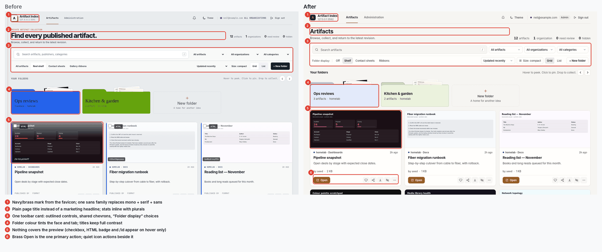
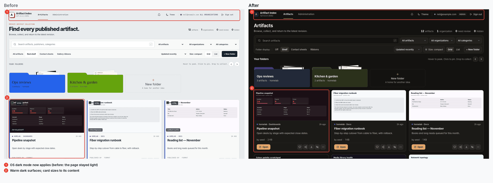
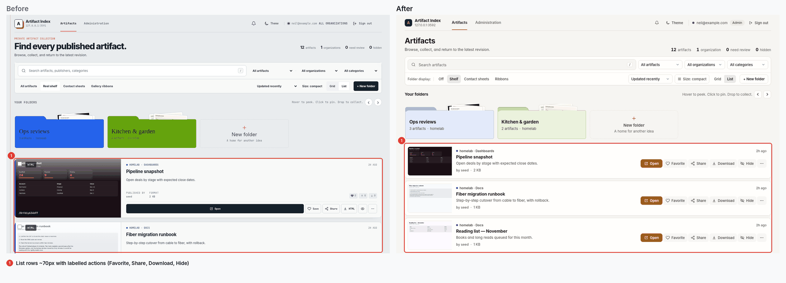
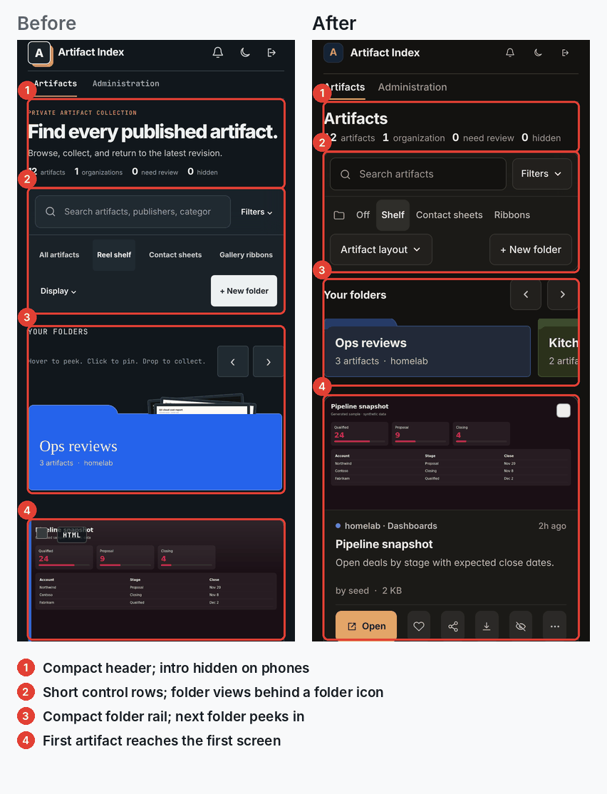
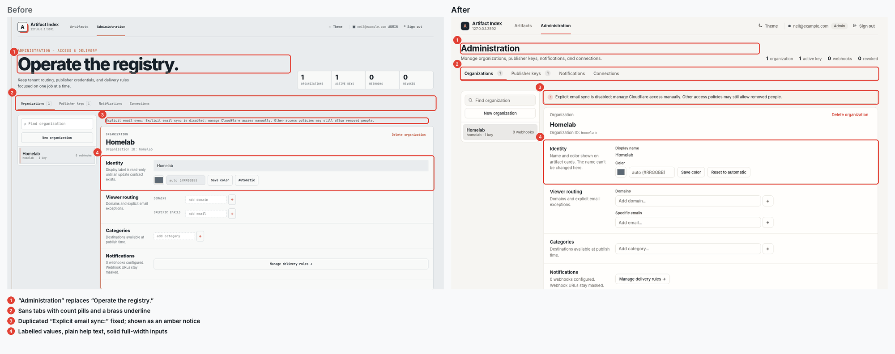
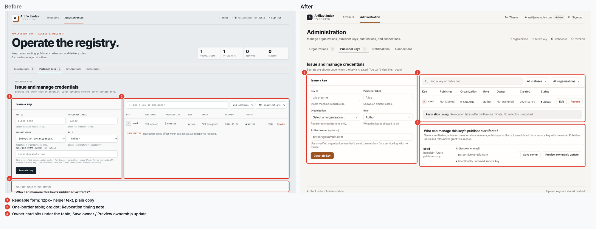
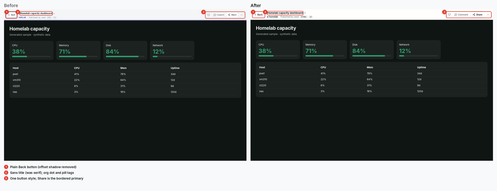

# UI refresh, November 2026

This refresh restyles the gallery, viewer bar, administration, dialogs, error pages, and phone
layouts. It keeps every route, control, and data flow. Most of the change is CSS, plus copy edits
in the templates and three asset scripts.

## What changed

- One sans family for all interface text. Monospace remains only for IDs, keys, dates in tables,
  and keyboard hints. Serif headings and monospace labels are gone.
- Interface text is at least 12px. The old layers used 8 to 10px uppercase labels.
- A warm paper-and-brass palette in light and dark, and the navy and brass mark from the favicon.
  The gallery now follows the operating-system dark setting when no theme is saved.
- Brass marks the one primary action on each surface (Open, Create link, Generate key). Other
  actions are quiet buttons with stroke icons. Text glyphs no longer stand in for icons.
- Cards size to their own content. Nothing covers the preview at rest. The selection box and
  `/id` chip appear on hover or focus, and the selection box is always visible on touch.
- Folder faces use a tint of the folder colour, so titles keep full contrast.
- Plain page titles and copy: "Artifacts" and "Administration", "Folder display", "Artifact
  owner", "Revocation timing".

## Where the styles live

Each stylesheet ends with a block headed `UI refresh (2026-11)`, followed by short lettered passes.
Those blocks own the design tokens (`--font-ui`, `--font-mono`, the palette, `--radius`) and the
surface treatment. The earlier layers above them still provide structure. Put new visual rules at
the end of the file so they win the cascade.

## Before and after

All captures use synthetic sample artifacts on a local server, Chrome 156 in headless mode, a
1440 × 900 desktop viewport at device scale 1, and a 390 × 844 phone viewport at scale 2. The
capture host maps the system UI font to Inter and monospace to JetBrains Mono, for both sets. The
numbered boxes point at the changes listed under each image.

