# UI refresh, November 2026

This refresh restyles the gallery, viewer bar, administration, dialogs, error pages, and phone
layouts. It came in two passes. The first pass (#151) is a visual refresh. The second pass (#152,
merged into #151) changes the gallery's information architecture. Routes, permissions, and data
flow stay the same.

## Visual refresh

- One sans family for interface text. Monospace remains only for IDs, keys, dates in tables, and
  keyboard hints. Interface text is at least 12px; the old layers used 8 to 10px uppercase labels.
- A warm paper-and-brass palette in light and dark, and the navy and brass mark from the favicon.
  The gallery now follows the operating-system dark setting when no theme is saved.
- Brass marks the primary action in each form and dialog (Create link, Generate key, Create folder,
  Send feedback). Other actions are quiet buttons with stroke icons. Text glyphs no longer stand
  in for icons.
- Cards size to their own content, and nothing covers the preview at rest. The selection box and
  `/id` chip appear on hover or focus, and the selection box is always visible on touch.
- Folder faces use a tint of the folder colour, so titles keep full contrast.
- Plain copy: "Artifacts", "Administration", "Artifact owner", "Revocation timing".

## Information architecture pass

- One View menu holds folder display, Grid or List, and preview size, so the gallery toolbar fits
  on one row. Each folder display option has a one-line description.
- The whole card opens the artifact through a stretched title link. The Open button is gone.
  Favorite, Share, and More stay on the card; Download and Hide or Show moved into More.
- Page, folder, and card titles use Fraunces, a self-hosted display face. Controls and body text
  stay sans.
- The toolbar shows New folder only when the shelf's New folder tile is off-screen.
- Hidden artifacts carry a "Hidden" tag. Phones keep 44px targets and do not scroll sideways at
  320px.

## Where the styles live

Each stylesheet ends with a block headed `UI refresh (2026-11)`, followed by short lettered passes.
Those blocks own the design tokens (`--font-ui`, `--font-title`, `--font-mono`, the palette,
`--radius`) and the surface treatment. The earlier layers above them still provide structure. Put
new visual rules at the end of the file so they win the cascade.

The display face is `assets/fonts/fraunces-v1.woff2` (SIL OFL 1.1, licence in
`assets/licenses/fraunces-OFL.txt`), served from `/fonts/fraunces-v1.woff2` with immutable caching.
Change the file name when the bytes change.

## Before and after

All captures use synthetic sample artifacts on a local server, Chrome 156 in headless mode, a
1440 × 900 desktop viewport at device scale 1, and a 390 × 844 phone viewport at scale 2. The
capture host maps the system UI font to Inter and monospace to JetBrains Mono, for both sets. The
numbered boxes point at the changes listed under each image.

### Visual refresh: original UI to #151

### Information architecture pass: #151 to #152

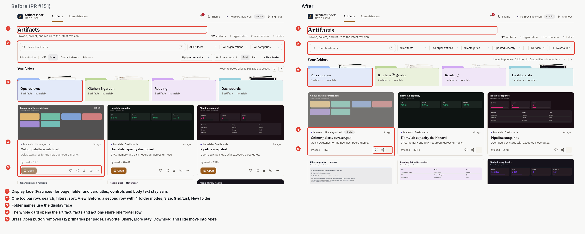

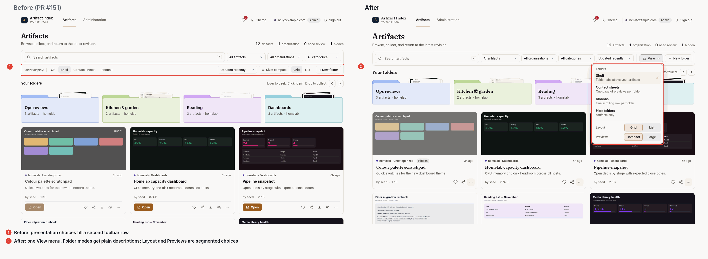

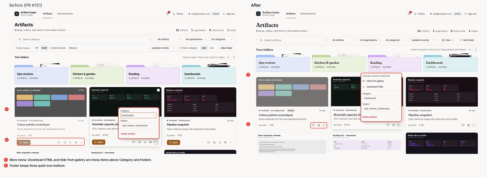

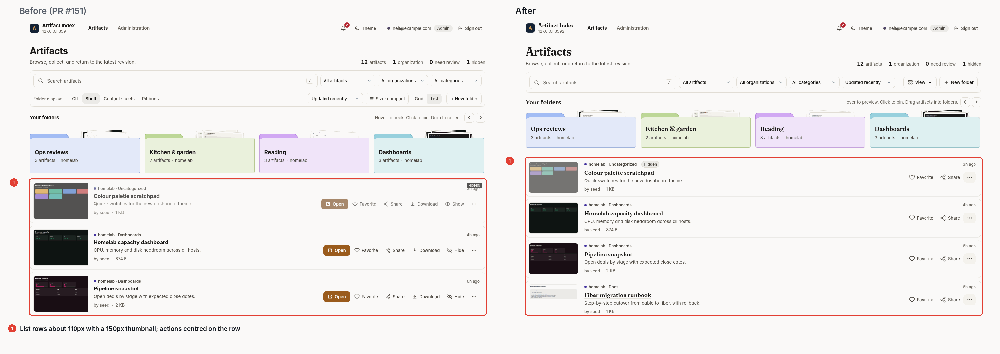

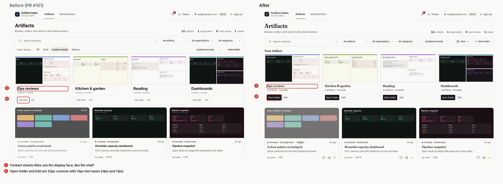

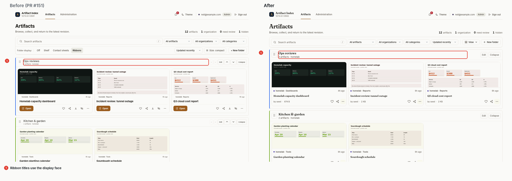

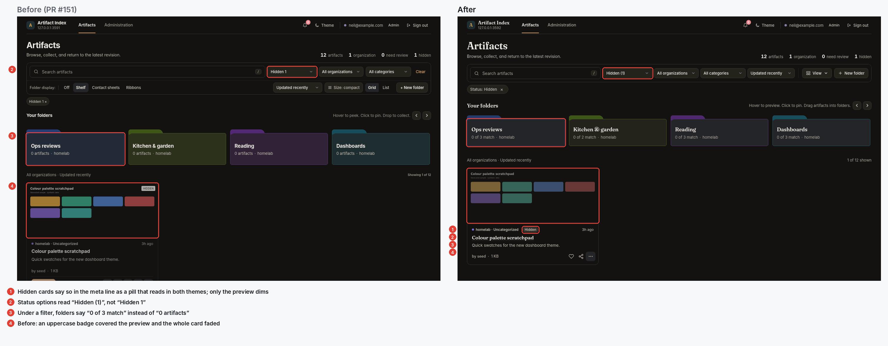

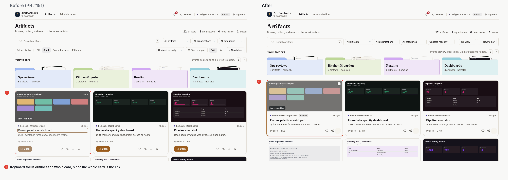

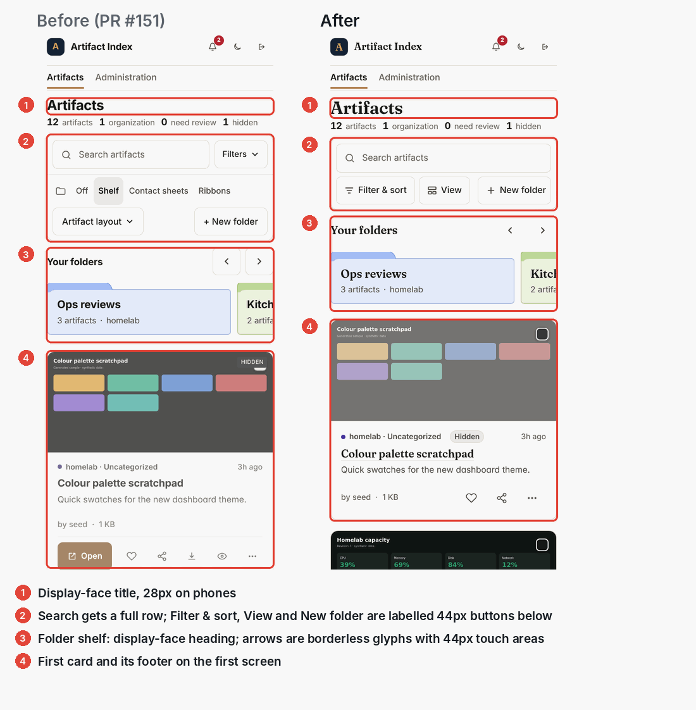

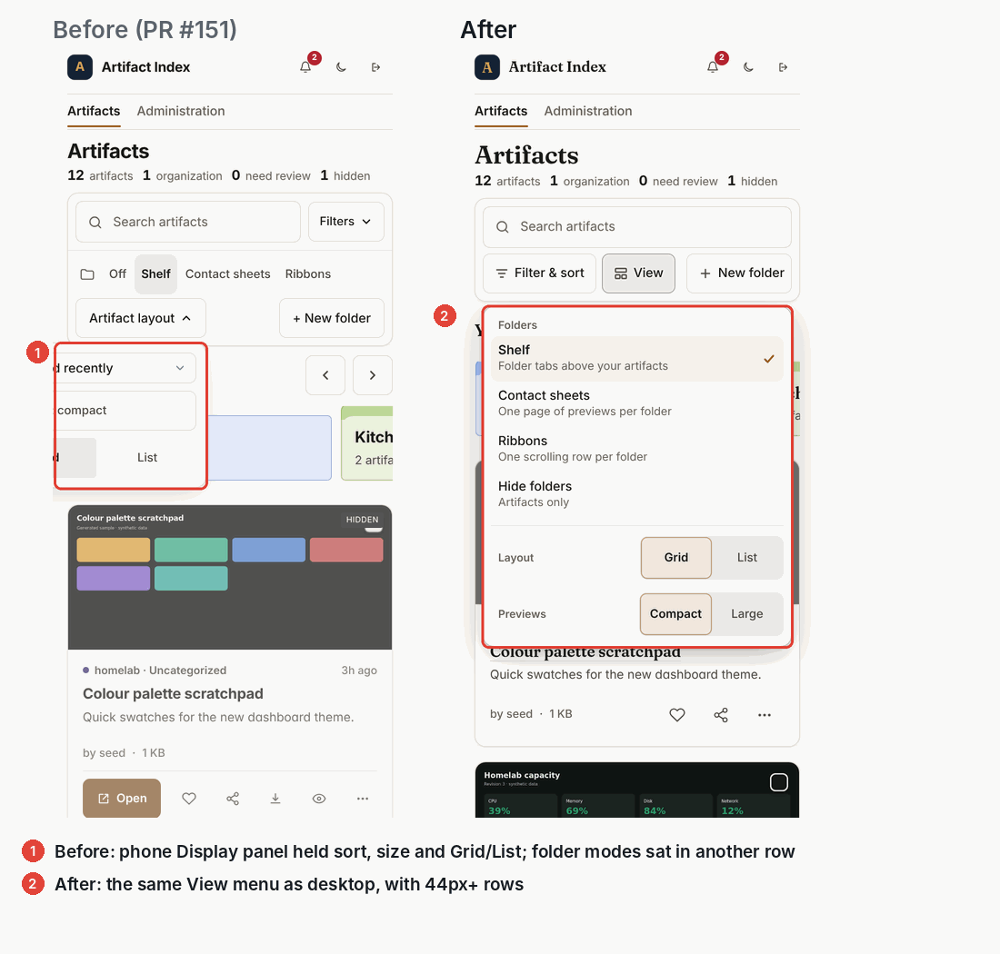

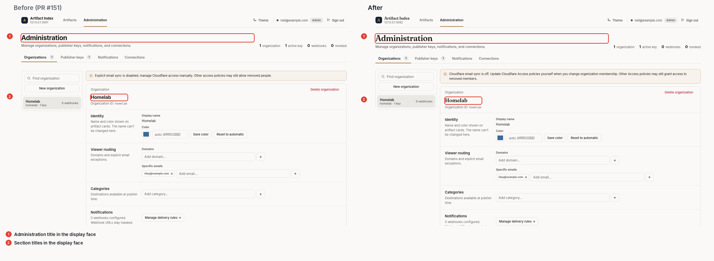

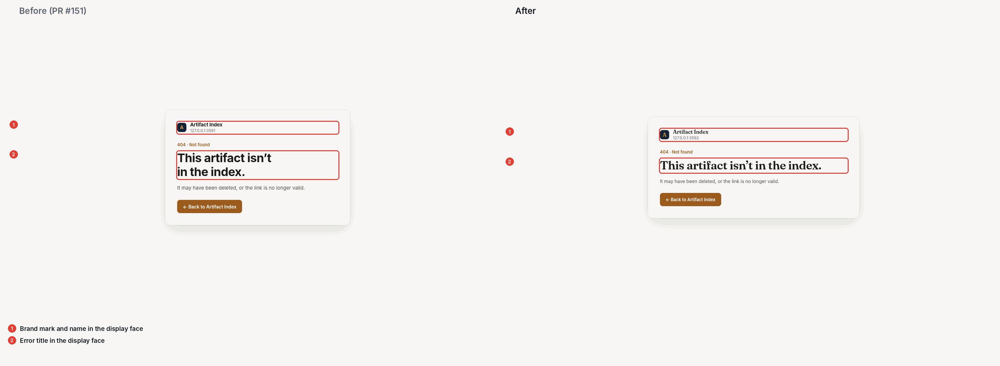
