# Screenshot gallery

Screenshots 01–14 show the November 2026 UI refresh, including its information architecture pass
(v1.29.4 plus #151 and #152), on an isolated local server at schema 40. The library holds twelve
fictional artifacts in the `homelab` organization, four folders, one member account, a feedback
thread, and three revisions of one artifact. The previews were rendered from those sample pages. No
production data or credentials appear in these images. They use the shipped light theme. The hero
image (00) is unchanged.

Captures use Chrome 156 in headless mode with reduced motion. Screenshots 01–08 use a 1600 × 1000
viewport and 09–11 use 1440 × 1080, both at a device scale factor of 1. The folder dialogs are
cropped to their rendered bounds. The mobile example uses a 390 × 844 viewport; it demonstrates
browser viewport emulation, not a physical device test. Titles use the self-hosted Fraunces face.
The capture host maps the system UI font to Inter and monospace to JetBrains Mono. Captures wait
for fonts and decoded previews. See [the refresh notes](../design/ui-refresh-2026-11.md) for before
and after comparisons.

| Shelf | Contact sheets |
|---|---|
| [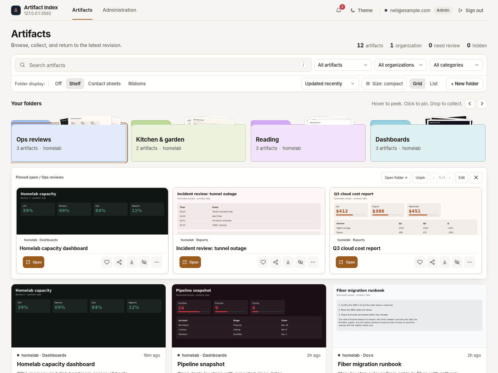](09-library-reel-shelf.png) | [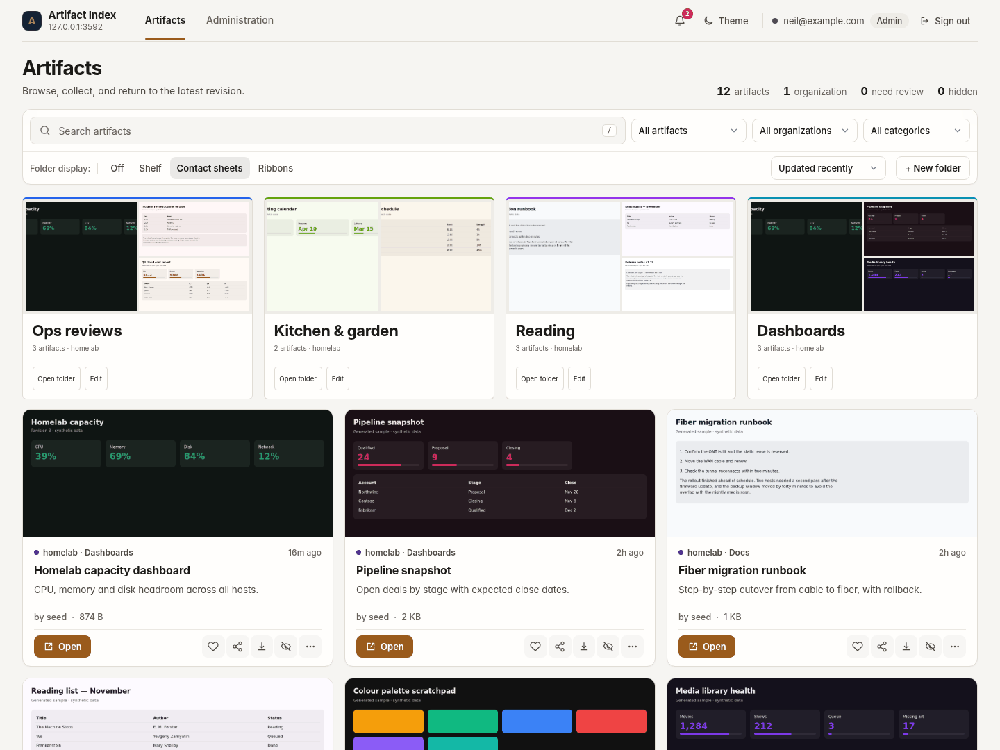](10-library-contact-sheets.png) |
| Hover to peek, click to pin, and drag artifact cards onto folders. | Each folder cover shows several artifact previews. |

| Ribbons | Create a folder |
|---|---|
| [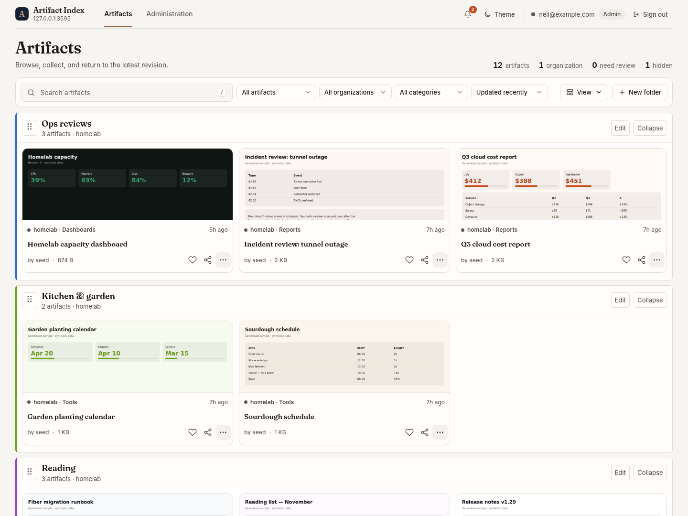](11-library-gallery-ribbons.png) | [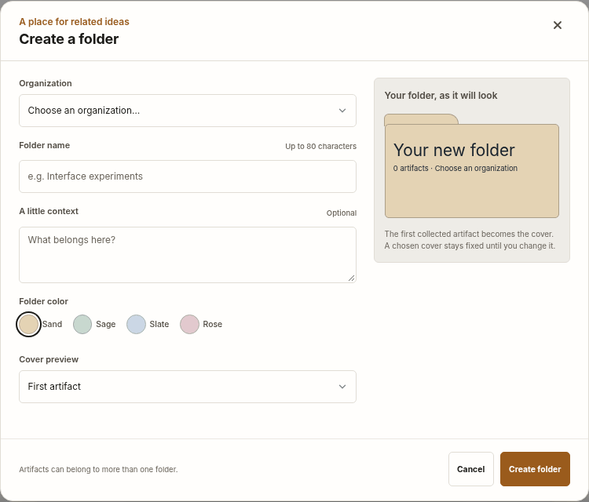](12-folder-create.png) |
| Reorder folders with drag or arrow controls. Collapsed ribbons retain a preview fan. | Set the name, optional context, color, and cover while viewing the folder preview. |

| Delete a folder | Mobile folder editor |
|---|---|
| [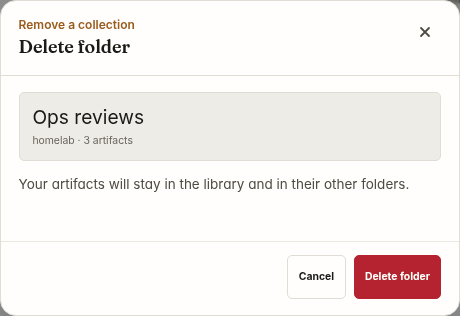](13-folder-delete.png) | [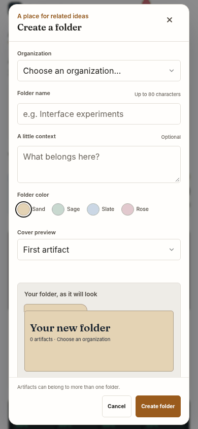](14-folder-create-mobile.png) |
| The confirmation identifies the folder and explains that artifacts remain available. | The body scrolls while the header and action buttons remain visible. |

| Administrator gallery | Card actions |
|---|---|
| [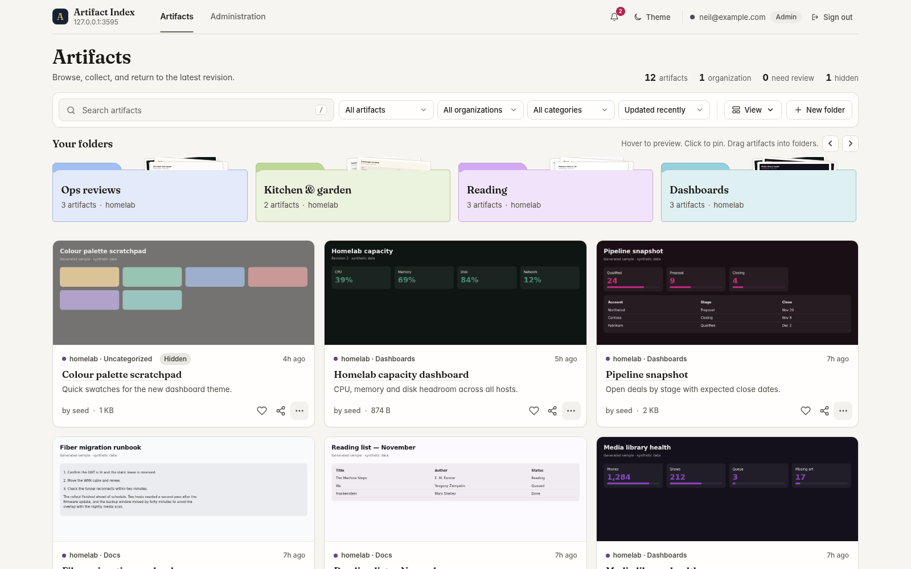](01-gallery-admin-grid.png) | [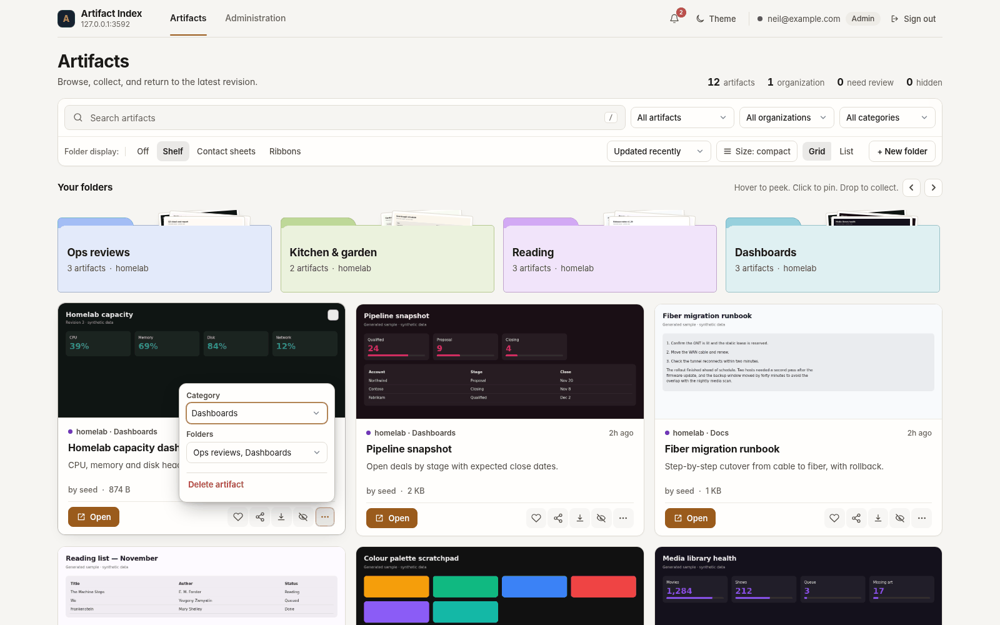](02-gallery-admin-actions.png) |
| Search, status, organization and category filters, sorting, and a View menu for folder display, layout, and preview size share one toolbar row. Click anywhere on a card to open it. | The More menu holds Download, Hide or Show, category, and folders. Deletion remains explicit and confirmed. |

| List layout | Member gallery |
|---|---|
| [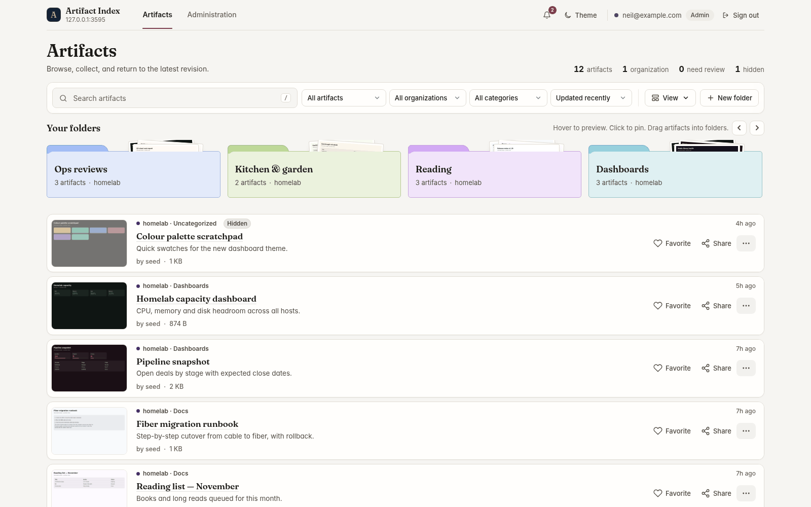](03-gallery-admin-list.png) | [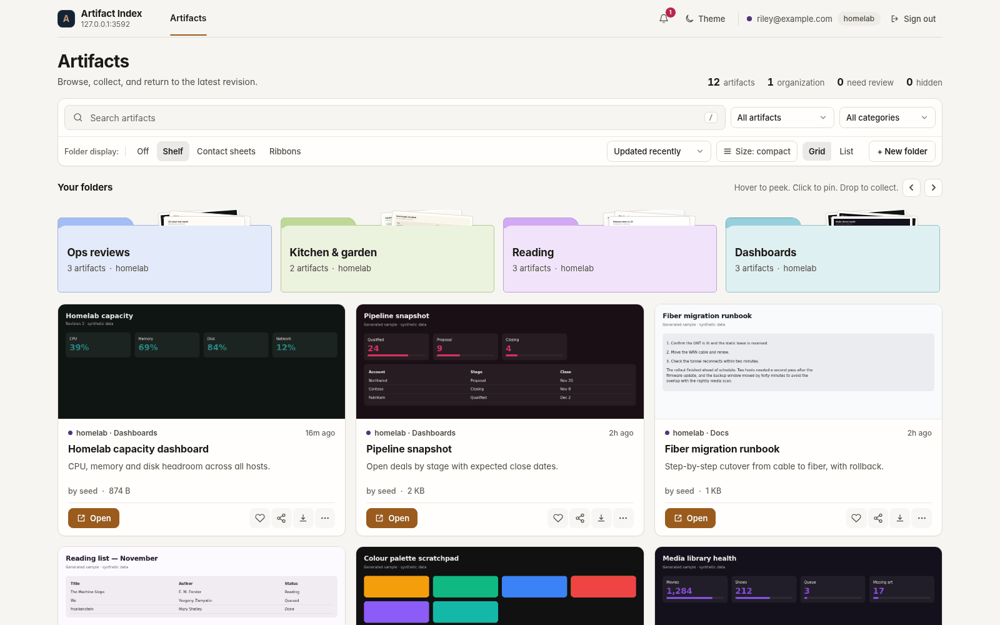](04-gallery-member-grid.png) |
| Compact rows keep previews, metadata, and actions in one line. | Members see organization-scoped counts and filters, and ownership controls for their own uploads. |

| Feedback | Version history |
|---|---|
| [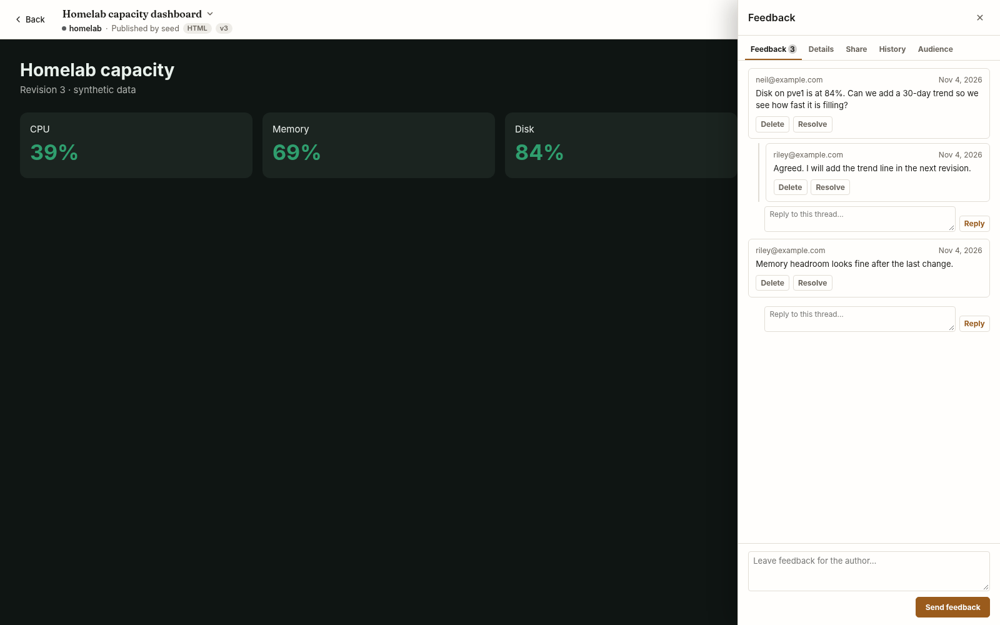](05-viewer-feedback.png) | [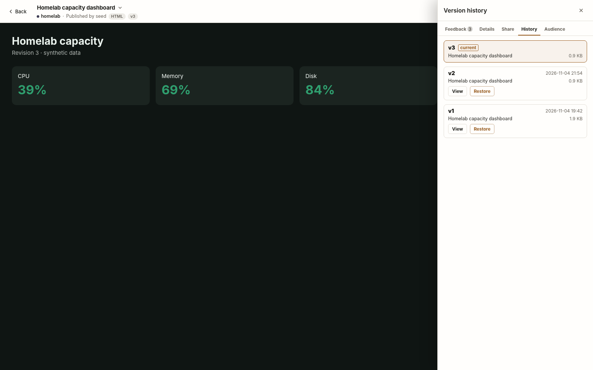](06-viewer-history.png) |
| The inspector holds threaded feedback beside the sandboxed artifact. Feedback can also pin to a point or region. | Browse retained revisions or restore an older body as a new revision. |

| Organization administration | Publisher credentials |
|---|---|
| [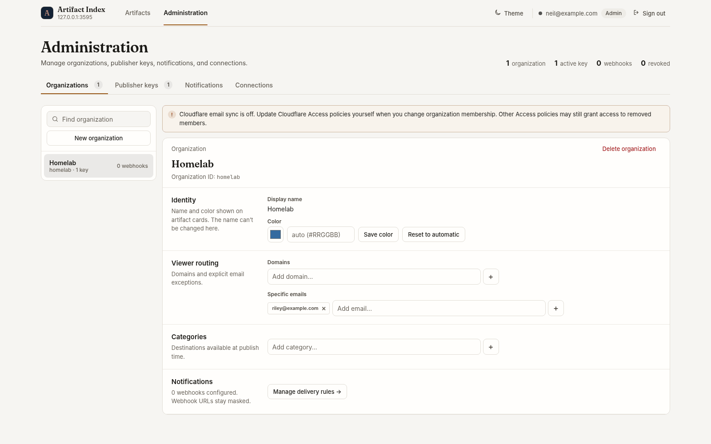](07-admin-organizations.png) | [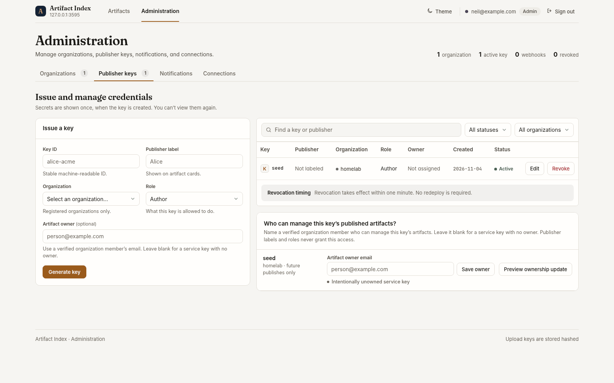](08-admin-publisher-keys.png) |
| Manage routing, colors, categories, members, and delivery settings for one organization. | Issue and revoke scoped keys, name an artifact owner, and preview ownership updates. |

[Return to the README](../../README.md).
